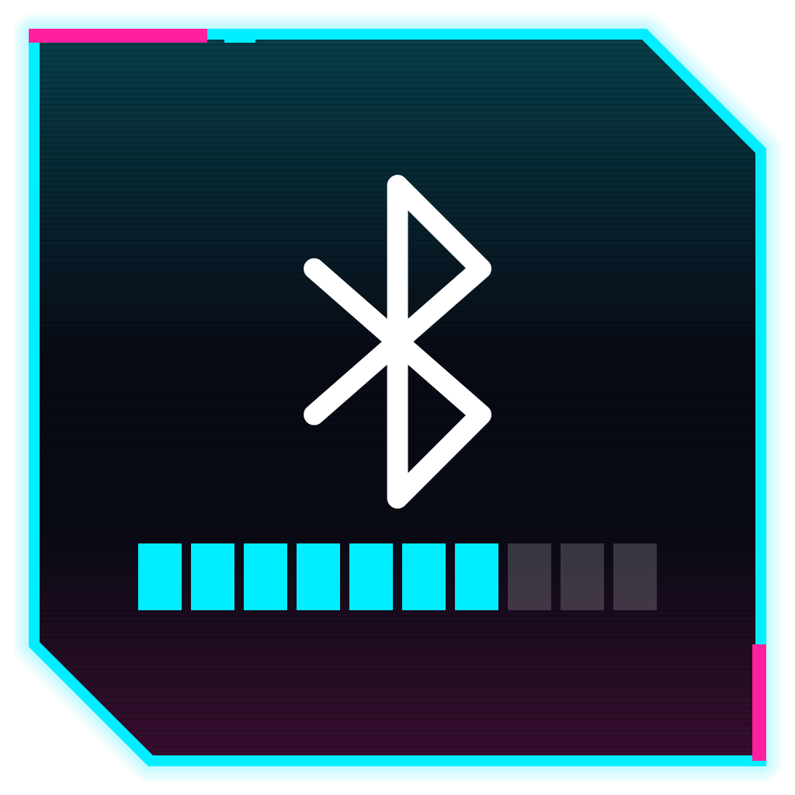
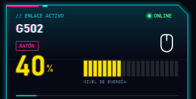

<p align="center"></p>

# Wireless Device Monitor Battery

[English](README.md) · **Español**

Batería de tus dispositivos Bluetooth (ratón, teclado, auriculares…) en la barra de tareas de Windows.


Al pasar el cursor por encima de un dispositivo se abre un panel con su información:



## Características

- **Minúsculo:** ~30 KB y alrededor de 1 MB de RAM en reposo, 0 % de CPU. Sin servicios en segundo plano, sin instalador, sin dependencias.
- **Sin descargar nada:** usa solo componentes que ya trae Windows (.NET Framework 4 y la fuente Segoe Fluent Icons).
- **Se integra en la barra de tareas:** es una ventana hija de la propia barra, así que aparece y desaparece con ella (menú Inicio, mostrar escritorio, apps minimizadas…) y se coloca justo a la izquierda de la bandeja.
- **Iconos nítidos:** los iconos y el texto se dibujan como vectores, sin borrosidad en pantallas 4K / alto DPI.
- **Panel al pasar el cursor:** nombre, tipo de dispositivo, estado (online/offline), nivel de energía, si está cargando, tipo de enlace, dirección Bluetooth y fuente de energía.
- **Colores por nivel:** cian, amarillo (≤ 50 %), rojo (≤ 20 %), verde si está cargando.
- **Detecta dispositivos solo:** muestra automáticamente cualquier dispositivo Bluetooth cuya batería lea Windows. Compatible con tema claro y oscuro.
- **Bilingüe:** la interfaz sigue el idioma de Windows (español o inglés). Puedes forzarlo con `--lang es` o `--lang en`.

## Uso

1. Descarga el `.zip` desde [Releases](../../releases) y descomprímelo en una carpeta fija.
2. Ejecuta `WirelessDeviceMonitorBattery.exe`.
3. Opcional: `install_startup.bat` lo añade al inicio de Windows; `uninstall.bat` lo quita y lo cierra.

Clic derecho sobre el widget: lista de dispositivos, *Actualizar ahora* y *Salir*. Se actualiza solo cada 5 minutos.

> Windows puede mostrar el aviso "Windows protegió su PC" (SmartScreen) porque el `.exe` no está firmado.
> Si prefieres no ejecutar un binario descargado, compílalo tú mismo (ver abajo).

## Compilar

No necesitas instalar nada: Windows incluye el compilador de C#.

```bat
build.bat
```

o directamente:

```bat
%WINDIR%\Microsoft.NET\Framework\v4.0.30319\csc.exe /target:winexe /optimize+ /platform:x86 /out:WirelessDeviceMonitorBattery.exe /r:System.Windows.Forms.dll /r:System.Drawing.dll src\WirelessDeviceMonitorBattery.cs
```

## Cómo funciona

- Lee la propiedad de batería que Windows expone para cada dispositivo Bluetooth
  (`{104EA319-6EE2-4701-BD47-8DDBF425BBE5}`, pid 2) con la API `CfgMgr32`, sin usar PowerShell ni WMI.
- Dibuja el widget con una ventana *layered* transparente (`UpdateLayeredWindow`) y la convierte en hija de `Shell_TrayWnd`.
- El panel es otra ventana transparente que aparece con un fundido corto.

## Limitaciones

- Solo aparecen dispositivos cuya batería Windows lea por Bluetooth. Los que usan un receptor USB propio del fabricante
  (algunos Logitech, Razer, SteelSeries, Corsair…) no se muestran.
- Los dispositivos Bluetooth LE informan de su batería cuando cambia, no a petición; el valor mostrado es el último que reportaron.
- Pensado para Windows 11 (barra de tareas centrada). En Windows 10 puede requerir ajustes de posición.
- Solo el monitor principal.

## Licencia

[MIT](LICENSE)
