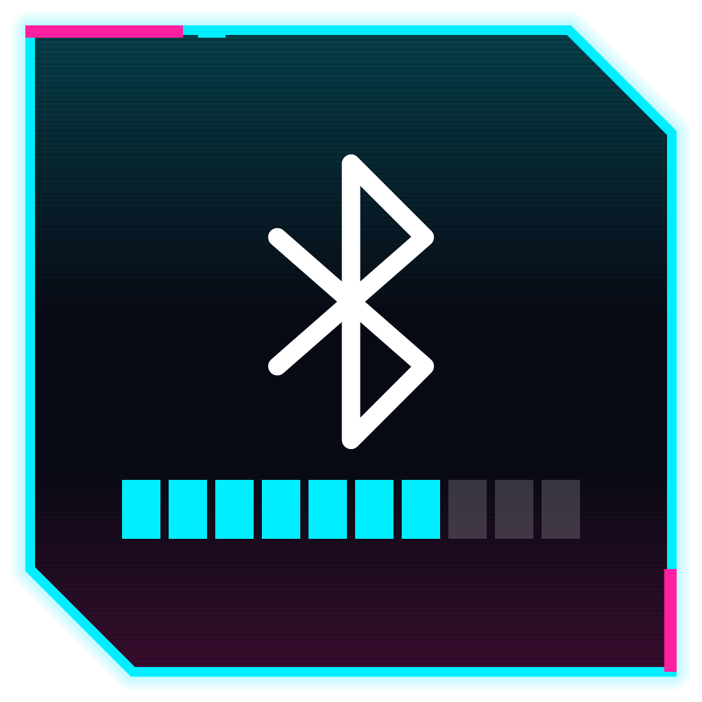
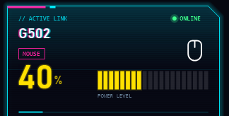

<p align="center"></p>

# Wireless Device Monitor Battery

**English** · [Español](README.es.md)

Battery level of your Bluetooth devices (mouse, keyboard, headset…) right on the Windows taskbar.


Hover over a device to open a panel with its details:



## Features

- **Tiny:** ~30 KB and about 1 MB of RAM when idle, 0 % CPU. No background services, no installer, no dependencies.
- **Nothing to download:** it only uses components already included in Windows (.NET Framework 4 and the Segoe Fluent Icons font).
- **Lives in the taskbar:** it is a child window of the taskbar itself, so it shows and hides with it (Start menu, show desktop, minimized apps…) and sits right next to the system tray.
- **Crisp icons:** icons and text are drawn as vectors, sharp on 4K / high-DPI screens.
- **Hover panel:** device name, type, status (online/offline), power level, charging state, link type, Bluetooth address and power source.
- **Level colors:** cyan, yellow (≤ 50 %), red (≤ 20 %), green while charging.
- **Finds devices on its own:** automatically shows any Bluetooth device whose battery Windows can read. Works with light and dark themes.
- **Bilingual:** the interface follows your Windows language (Spanish or English). Force it with `--lang en` or `--lang es`.

## Usage

1. Download the `.zip` from [Releases](../../releases) and extract it to a permanent folder.
2. Run `WirelessDeviceMonitorBattery.exe`.
3. Optional: `install_startup.bat` adds it to Windows startup; `uninstall.bat` removes it and closes the app.

Right-click the widget for the device list, *Refresh now* and *Exit*. It refreshes by itself every 5 minutes.

> Windows may show a "Windows protected your PC" (SmartScreen) warning because the `.exe` is not signed.
> If you would rather not run a downloaded binary, build it yourself (see below).

## Build

Nothing to install: Windows already ships the C# compiler.

```bat
build.bat
```

or directly:

```bat
%WINDIR%\Microsoft.NET\Framework\v4.0.30319\csc.exe /target:winexe /optimize+ /platform:x86 /out:WirelessDeviceMonitorBattery.exe /r:System.Windows.Forms.dll /r:System.Drawing.dll src\WirelessDeviceMonitorBattery.cs
```

## How it works

- Reads the battery property Windows exposes for every Bluetooth device
  (`{104EA319-6EE2-4701-BD47-8DDBF425BBE5}`, pid 2) through the `CfgMgr32` API, without PowerShell or WMI.
- Draws the widget as a transparent layered window (`UpdateLayeredWindow`) re-parented to `Shell_TrayWnd`.
- The panel is a second transparent window that fades in.

## Limitations

- Only devices whose battery Windows can read over Bluetooth are shown. Devices that use a vendor-specific USB receiver
  (some Logitech, Razer, SteelSeries, Corsair…) will not appear.
- Bluetooth LE devices report their battery when it changes, not on request; the value shown is the last one they reported.
- Designed for Windows 11 (centered taskbar). Windows 10 may need position tweaks.
- Primary monitor only.

## License

[MIT](LICENSE)
